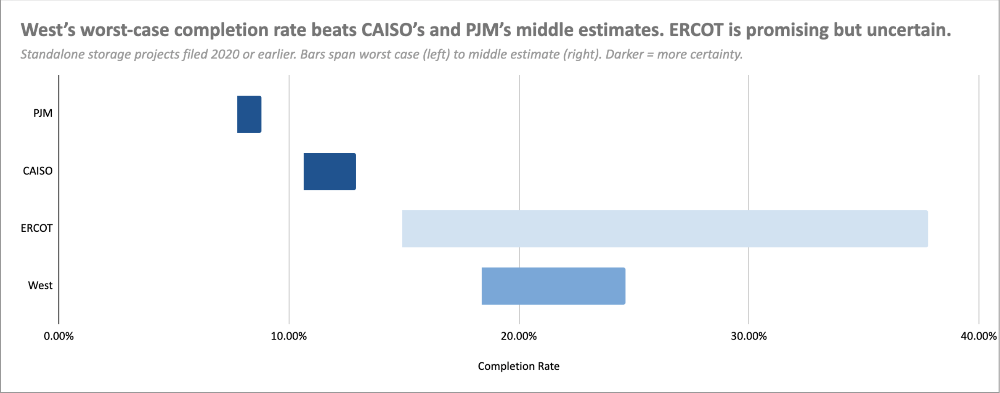

# Where Should a Storage Developer File? Interconnection Queue Analysis

**Question:** The VP of Development at an energy storage firm is asking which region to file a new storage project in.

**Answer:** Based on interconnection success alone, the West ranks highest among regions to file a new energy storage project in.

**Tools:** Google Sheets (pivot tables, COUNTIFS, XLOOKUP, named ranges)

📄 **[Read the 1-page client memo (PDF)](memo.pdf)**

## Key finding

West's worst-case completion rate (18%) beats CAISO's (13%) and PJM's (9%) middle estimates. ERCOT is promising (38% middle estimate) but uncertain, with 61% of projects filed in 2020 or earlier still waiting.

## Data

**Source:** [Queued Up: 2026 Edition](https://eta-publications.lbl.gov/publications/us-interconnection-queue-data-0) (data through the end of 2025), Lawrence Berkeley National Laboratory & GridTracker. Licensed CC BY 4.0.

The dataset covers interconnection queues for more than 50 US transmission grid operators, representing about 98% of currently installed US electric generating capacity. It includes requests submitted to queues through the end of 2025, and only includes generation requests seeking to connect to the transmission grid.

- **Main analysis:** standalone storage projects filed in 2020 or earlier (1,538 projects). I measured by project count rather than capacity, because counts reflect the odds that any single project gets built, which is the developer's question.
- **Year-5 test:** all project types filed in 2015 or earlier, CAISO and PJM only (see [Data issues](#data-issues-i-found-and-how-i-handled-them) for why the others were excluded).
- **Sanity check:** Berkeley Lab reports that 13% of all capacity requested from 2000 to 2020 had been built by the end of 2025 (all project types). My storage floors (8–18%, by project count) fall in a similar range, though the two aren't directly comparable.

## Method

**Measures.** The *floor* is the completion percentage if every waiting project fails (`operational / all projects`). The *middle estimate* is the share built among projects that have either been built or abandoned (`operational / (operational + withdrawn)`).

**Ranking rule.** A region ranks above another only if its floor beats the other's middle estimate.

**Reliability rule.** A region is considered reliable if it has 20 or more built projects and less than 20% of projects still waiting.
- *20 built projects:* with fewer, one project would shift the rate by more than 5% of its value.
- *20% still waiting:* it's the national average, and it falls in the natural break between CAISO (about 17.7%) and West (about 25.3%).

Only CAISO and PJM met both thresholds. West failed the waiting-share threshold and is shown as uncertain. ERCOT failed both thresholds, but I kept it as a judgment call because it's a major storage market and close to the line. The remaining five regions were excluded for insufficient data.

**Year-5 test.** "Still waiting at year 5" means no build or withdrawal date within five years of filing; still-active and suspended projects count as waiting. The comparison group is projects built or withdrawn within five years. In CAISO and PJM, projects still waiting five years after filing were more likely to be built than projects that reached an outcome within five years (45% vs. 7% in CAISO; 42% vs. 27% in PJM). This suggests the middle estimate understates the true completion rate, favoring regions with many waiting projects like West and ERCOT. This pattern comes from projects of all types filed in 2015 or earlier, so treat it as directional, not solid evidence.

## Data issues I found and how I handled them

**SPP counts didn't reconcile.** I calculated the completion rate of a cohort of all projects filed in 2015 or earlier.
- *Caught by:* for SPP, the whole-cohort rate was lower than both groups' rates, which doesn't add up because it should land between them. My first hypothesis was withdrawn projects missing dates, but after finding 0 unknowns, I concluded that some rows are falling outside of all groups.
- *Fix:* excluded SPP from further analysis.
- *Effect:* the year-5 finding rests on 2 regions, not 3. I ran the same reconciliation for CAISO and PJM: zero rows unaccounted for, so their results stand. Root cause not confirmed; I excluded SPP rather than spend time on a region the recommendation didn't depend on.

**Missing dates.** About 31% of built projects and 36% of withdrawn projects lack dates.
- *Caught by:* checking missing-date rates by region before running the year-5 test.
- *Fix:* ran the test only in regions under 5% missing (every major region except ERCOT), and rejected filling gaps with proposed dates, which are developers' optimistic targets, not actual dates.
- *Effect:* the year-5 finding can't be confirmed for ERCOT, the region the memo calls "promising."

**Incorrect chart bars.** My first table referenced cells by position, so the "PJM" bar showed ISO-NE's data and the "West" bar showed MISO's.
- *Caught by:* checking the chart's source values against the pivot table. The numbers matched the wrong regions.
- *Fix:* looked up values by region name, then replaced hand-typed numbers with formulas.
- *Effect:* caught before publishing. Left uncorrected, the chart would have shown West as the worst region, the opposite of the recommendation.

**Wrong header row.** Row 1 of the data tab holds a navigation link, not column names. My first pivot read it as the header, so the field names didn't match the columns, and I broke the table out by filing date instead of status.
- *Caught by:* a "too many columns" error.
- *Fix:* set the data range to start at row 2.
- *Effect:* none on results; caught before analysis.

## Limitations & next steps

- This analysis is based on completion rate alone → analyze revenue once connected.
- West spans many different utilities → shortlist the utilities with the most completed storage projects before filing.
- ERCOT's estimate rests on 17 completions → monitor as waiting projects resolve; if its worst-case rate rises above West's 18%, prioritize ERCOT.

## Files

- **1-page memo:** [memo.pdf](memo.pdf) ([Google Doc version](https://docs.google.com/document/d/1Dlyqy_IKOrYr5ibBXreZHWbXUA8ciN_MHV60REknP7o/edit?usp=sharing))
- **Working spreadsheet:** [Queued Up Spreadsheet](https://docs.google.com/spreadsheets/d/1NzjePuwh5PL3NYfH-hSvF6y36SB3HnPxYoHwfOtFwsE/edit?usp=sharing)
- **Chart:** [images/chart.png](chart.png)
